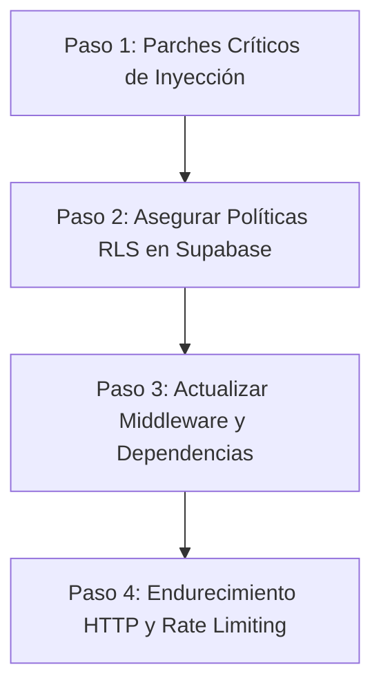

# Reporte de Auditoría de Seguridad — Proyecto Komy

**Fecha de Auditoría:** 24 de Octubre de 2026  
**Objetivo:** Aplicación Web Komy (Next.js 16 + Supabase SSR + Prisma ORM + PostgreSQL)  
**Alcance:** Endpoints, Server Actions, Autenticación y Manejo de Sesiones, Dependencias (CVEs), Políticas RLS de Supabase, Almacenamiento (Storage Buckets) e Inyecciones (XSS/Open Redirect).

---

## 1. Resumen Ejecutivo

Se ha completado una auditoría exhaustiva de seguridad sobre la arquitectura, código fuente, políticas de base de datos y dependencias de la plataforma **Komy**.

La plataforma cuenta con buenas prácticas fundamentales:
- Hash de contraseñas de mesero mediante **scrypt** determinista con salt derivada.
- Tokens de sesión de mesero almacenados en base de datos como hash **SHA-256** y transmitidos en cookies `httpOnly`, `sameSite: 'lax'`.
- La gran mayoría de los Server Actions verifican rigurosamente la propiedad del local contra el `userId` de Supabase Auth.
- No hay claves secretas de backend expuestas con prefijo `NEXT_PUBLIC_`.

Sin embargo, se identificaron **10 hallazgos de seguridad** clasificados desde **Crítico** hasta **Medio**, que requieren atención inmediata para prevenir manipulaciones de datos, accesos no autorizados, inyecciones de código y exposición indebida de credenciales.

### Matriz de Severidad

| Severidad | Cantidad | Categorías Principales |
| :--- | :---: | :--- |
| **Crítica** | 1 | Dependencias vulnerables (Next.js CVEs con RCE y bypass de proxy) |
| **Alta** | 5 | Inyecciones XSS almacenadas, IDOR en orden de productos, RLS permisivo en órdenes |
| **Media** | 4 | Fuga de `qrToken`, Open Redirect, Rate Limiting en meseros, Security Headers |

---

## 2. Hallazgos Detallados y Vulnerabilidades

### 🚨 Hallazgo 1: Vulnerabilidades Críticas y Altas en Librerías (`npm audit`)
- **Severidad:** Crítica (CVSS: 9.8) / Alta
- **Componentes Afectados:** `next`, `zod`, `nanoid`, `postcss`, `sharp`, `ws`
- **Diagnóstico:**
  El análisis automatizado con `npm audit` detectó **23 vulnerabilidades** (1 crítica, 16 altas, 5 moderadas).
  - **`next` (<16.4.3):**
    - `GHSA-26hh-7cqf-hhc6`: Bypass de Middleware/Proxy en App Router mediante segment-prefetch routes.
    - `GHSA-492v-c6pp-mqqv`: Bypass de Middleware mediante inyección de parámetros en rutas dinámicas.
    - `GHSA-p293-qw3h-jr36`: Ejecución remota de código (RCE) no autenticada en servidores Windows.
    - DoS en Server Actions y Server Components (`GHSA-m99w-x7hq-7vfj`, `GHSA-q4gf-8mx6-v5v3`).
  - **`zod` (<4.6.6):** Denegación de servicio por agotamiento de memoria (`GHSA-mrhx-c7xc-m3w5`).
  - **`nanoid` (<=3.3.17):** Bucles infinitos con argumentos numéricos negativos (`GHSA-28wg-ghj8-5hjv`).

#### 🛠️ Solución
Actualizar las dependencias a versiones seguras:
```bash
npm install next@16.4.3 zod@latest nanoid@latest
npm audit fix
```

---

### 🚨 Hallazgo 2: Broken Access Control / IDOR en Reordenamiento de Menús
- **Severidad:** Alta (CVSS: 7.5)
- **Archivo:** `src/actions/menu.ts` (Líneas 313–370)
- **Vulnerabilidad:**
  En `updateProductsOrder(orderedIds: string[])` y `updateCategoriesOrder(orderedIds: string[])`:
  ```typescript
  export async function updateProductsOrder(orderedIds: string[]) {
      const supabase = await createClient()
      const { data: { user } } = await supabase.auth.getUser()
      if (!user) throw new Error("No autenticado")

      // ❌ VULNERABILIDAD: Se actualiza cualquier ID sin validar si pertenece al local del usuario
      await prisma.$transaction(
          orderedIds.map((id, index) =>
              prisma.product.update({
                  where: { id },
                  data: { order: index }
              })
          )
      )
  }
  ```
- **Impacto:**
  Cualquier usuario autenticado de la Tienda "A" puede enviar identificadores de productos o categorías de la Tienda "B", alterando el orden de visualización de su competencia.

#### 🛠️ Solución
Validar que todos los `orderedIds` pertenezcan a la tienda del usuario autenticado antes de ejecutar el update:
```typescript
export async function updateProductsOrder(orderedIds: string[]) {
    const supabase = await createClient()
    const { data: { user } } = await supabase.auth.getUser()
    if (!user) throw new Error("No autenticado")

    // ✅ Verificar que todos los productos pertenecen a este usuario
    const userProducts = await prisma.product.findMany({
        where: {
            id: { in: orderedIds },
            category: { store: { userId: user.id } }
        },
        select: { id: true, category: { select: { store: { select: { slug: true } } } } }
    })

    if (userProducts.length !== orderedIds.length) {
        throw new Error("No autorizado: uno o más productos no pertenecen a tu local.")
    }

    await prisma.$transaction(
        orderedIds.map((id, index) =>
            prisma.product.update({
                where: { id },
                data: { order: index }
            })
        )
    )

    if (userProducts.length > 0) {
        revalidateMenu(userProducts[0].category.store.slug)
    }
    revalidatePath('/dashboard/products')
}
```

---

### 🚨 Hallazgo 3: Stored XSS en Vista Previa de WhatsApp
- **Severidad:** Alta (CVSS: 7.2)
- **Archivo:** `app/dashboard/settings/SettingsForm.tsx` (Líneas 218–223)
- **Vulnerabilidad:**
  ```tsx
  const formatWhatsAppText = (text: string) => {
      return text.split('\n').map((line, i) => {
          // ❌ No se escapan entidades HTML (<, >, ", ') antes de inyectar en el DOM
          const formatted = line.replace(/\*(.*?)\*/g, '<strong>$1</strong>');
          return <div key={i}>{formatted ? <span dangerouslySetInnerHTML={{ __html: formatted }} /> : <br />}</div>;
      });
  };
  ```
- **Impacto:**
  Si un atacante introduce `` en `whatsappHeader` o `whatsappFooter`, el payload se guarda en la base de datos y se ejecuta en el navegador de cualquier administrador que abra la página de configuración.

#### 🛠️ Solución
Escapar caracteres HTML antes de reemplazar el formato de asteriscos:
```tsx
const escapeHtml = (str: string) =>
    str.replace(/&/g, '&amp;')
       .replace(/</g, '&lt;')
       .replace(/>/g, '&gt;')
       .replace(/"/g, '&quot;')
       .replace(/'/g, '&#039;');

const formatWhatsAppText = (text: string) => {
    return text.split('\n').map((line, i) => {
        const safe = escapeHtml(line);
        const formatted = safe.replace(/\*(.*?)\*/g, '<strong>$1</strong>');
        return <div key={i}>{formatted ? <span dangerouslySetInnerHTML={{ __html: formatted }} /> : <br />}</div>;
    });
};
```

---

### 🚨 Hallazgo 4: Inyección CSS/HTML y XSS en Tipografías Dinámicas
- **Severidad:** Alta (CVSS: 7.4)
- **Archivos:** `app/components/SharedMenuUI.tsx` (Línea 226), `app/components/AdvancedMenuUI.tsx` (Línea 1125), `src/types/customization.ts` (Línea 289)
- **Vulnerabilidad:**
  El esquema de Zod en `globalStyleSchema` solo valida `fontHeading: z.string().min(1)`.
  Luego en `SharedMenuUI` y `AdvancedMenuUI` se concatena directamente en una etiqueta `<style>`:
  ```tsx
  <style dangerouslySetInnerHTML={{
      __html: `
      @import url('${googleFontsUrl}');
      .font-epilogue { font-family: '${fontHeading}', sans-serif; }
      .font-manrope  { font-family: '${fontBody}', sans-serif; }
      `
  }} />
  ```
  Un valor como `'; } </style><script>alert(1)</script><style>` rompe la etiqueta `<style>` e inyecta JavaScript arbitrario que se ejecuta en el menú público `/menu/[slug]`, afectando a los clientes que visiten la tienda.

#### 🛠️ Solución
1. En `src/types/customization.ts`:
   ```typescript
   const fontNameSchema = z.string()
       .min(1)
       .max(50)
       .regex(/^[a-zA-Z0-9\s\-]+$/, 'Nombre de tipografía inválido');

   export const globalStyleSchema = z.object({
       // ...
       fontHeading: fontNameSchema,
       fontBody: fontNameSchema,
   });
   ```
2. Sanitizar antes de interpolar en el bloque `<style>`:
   ```typescript
   const sanitizeFont = (font: string) => font.replace(/[^a-zA-Z0-9\s\-]/g, '');
   ```

---

### 🚨 Hallazgo 5: Política RLS Permisiva en `public.orders` (Inyección Anónima Directa)
- **Severidad:** Alta (CVSS: 7.3)
- **Archivo:** `prisma/sql/orders-realtime.sql` (Líneas 68–73)
- **Vulnerabilidad:**
  ```sql
  CREATE POLICY "Permitir insercion de pedidos para clientes"
  ON public.orders
  FOR INSERT
  TO anon, authenticated
  WITH CHECK (true);
  ```
- **Impacto:**
  El flujo legítimo de creación de órdenes se ejecuta en el servidor mediante el Server Action `createPublicOrder` (utilizando la conexión directa de Prisma que no requiere RLS).
  Mantener `WITH CHECK (true)` concedido a `anon` permite que cualquier persona en internet con la `ANON_KEY` pública use `supabase.from('orders').insert({...})` para saturar el tablero Kanban de comandas en vivo (`/dashboard/pedidos`) con órdenes falsas, totales de $0 o estados completados.

#### 🛠️ Solución
Ejecutar en el Editor SQL de Supabase:
```sql
-- Revocar inserción directa anónima. Toda orden debe crearse vía Server Action
DROP POLICY IF EXISTS "Permitir insercion de pedidos para clientes" ON public.orders;
REVOKE INSERT ON TABLE public.orders FROM anon;
```

---

### ⚠️ Hallazgo 6: Fuga de Tokens Secretos de Mesa (`qrToken`) en PostgREST
- **Severidad:** Media (CVSS: 6.5)
- **Archivo:** `prisma/sql/tables-realtime.sql` (Líneas 14–37)
- **Vulnerabilidad:**
  ```sql
  CREATE POLICY "Mesas activas visibles" ON "Table" FOR SELECT TO anon USING ("isActive" = true);
  GRANT SELECT ON "Table" TO anon, authenticated;
  ```
  La columna `qrToken` de la tabla `"Table"` contiene el secreto opaco que valida si un comensal está en el salón. Aunque el backend en `getTableStatuses` omite `qrToken`, PostgREST expone todas las columnas de la tabla. Un usuario puede hacer:
  ```javascript
  const { data } = await supabase.from('Table').select('number, qrToken, storeId');
  ```
  obteniendo los tokens de todas las mesas de todos los restaurantes sin tener que escanear el QR físico.

#### 🛠️ Solución
Restringir el grant de columnas a nivel de Postgres:
```sql
REVOKE SELECT ON "Table" FROM anon;
GRANT SELECT ("id", "storeId", "number", "waiterId", "isActive", "createdAt") ON "Table" TO anon;
```

---

### ⚠️ Hallazgo 7: Open Redirect en Endpoint de Autenticación
- **Severidad:** Media (CVSS: 6.1)
- **Archivo:** `app/auth/callback/route.ts` (Líneas 10, 18, 29)
- **Vulnerabilidad:**
  ```typescript
  const next = searchParams.get('next') ?? '/dashboard'
  return NextResponse.redirect(`${origin}${next}`)
  ```
  Si el atacante genera un enlace con `?next=//sitio-falso.com`, la concatenación redirige a un dominio externo arbitrario tras iniciar sesión o verificar código OTP.

#### 🛠️ Solución
Validar que `next` sea una ruta relativa local segura:
```typescript
let next = searchParams.get('next') ?? '/dashboard'
if (!next.startsWith('/') || next.startsWith('//') || next.includes('\\')) {
    next = '/dashboard'
}
return NextResponse.redirect(new URL(next, origin))
```

---

### ⚠️ Hallazgo 8: Pérdida Potencial de Cookies de Sesión en `middleware.ts`
- **Severidad:** Media (CVSS: 5.3)
- **Archivo:** `middleware.ts` (Líneas 20–33)
- **Vulnerabilidad:**
  Cada invocación de `set` y `remove` reasigna `response = NextResponse.next(...)`, lo que sobreescribe las cabeceras `Set-Cookie` previas. Si Supabase emite tokens divididos (chunked cookies), las cookies anteriores se descartan, provocando cierres de sesión inesperados.
  Adicionalmente, el `matcher` no abarca rutas públicas, por lo que usuarios que navegan por el menú o la landing sufren expiración de token sin renovación automática.

#### 🛠️ Solución
Adoptar el estándar `getAll()` y `setAll()` de `@supabase/ssr`:
```typescript
import { createServerClient } from '@supabase/ssr'
import { NextResponse, type NextRequest } from 'next/server'

export async function middleware(request: NextRequest) {
    let response = NextResponse.next({
        request: { headers: request.headers },
    })

    const supabase = createServerClient(
        process.env.NEXT_PUBLIC_SUPABASE_URL!,
        process.env.NEXT_PUBLIC_SUPABASE_ANON_KEY!,
        {
            cookies: {
                getAll() {
                    return request.cookies.getAll()
                },
                setAll(cookiesToSet) {
                    cookiesToSet.forEach(({ name, value }) => request.cookies.set(name, value))
                    response = NextResponse.next({ request })
                    cookiesToSet.forEach(({ name, value, options }) =>
                        response.cookies.set(name, value, options)
                    )
                },
            },
        }
    )

    const { data: { user } } = await supabase.auth.getUser()

    if ((request.nextUrl.pathname.startsWith('/dashboard') || request.nextUrl.pathname.startsWith('/onboarding')) && !user) {
        return NextResponse.redirect(new URL('/login', request.url))
    }

    if ((request.nextUrl.pathname.startsWith('/login') || request.nextUrl.pathname.startsWith('/register')) && user) {
        return NextResponse.redirect(new URL('/dashboard', request.url))
    }

    return response
}

export const config = {
    matcher: [
        '/((?!_next/static|_next/image|favicon.ico|.*\\.(?:svg|png|jpg|jpeg|gif|webp)$).*)',
    ],
}
```

---

### ⚠️ Hallazgo 9: Ausencia de Cabeceras HTTP de Seguridad (Security Headers)
- **Severidad:** Media (CVSS: 5.0)
- **Archivo:** `next.config.ts`
- **Vulnerabilidad:**
  No se emiten cabeceras `X-Frame-Options` (vulnerable a Clickjacking dentro de iframes), `X-Content-Type-Options: nosniff`, `Referrer-Policy` ni `Strict-Transport-Security`.

#### 🛠️ Solución
Incorporar en `next.config.ts`:
```typescript
const securityHeaders = [
  { key: 'X-DNS-Prefetch-Control', value: 'on' },
  { key: 'Strict-Transport-Security', value: 'max-age=63072000; includeSubDomains; preload' },
  { key: 'X-Frame-Options', value: 'SAMEORIGIN' },
  { key: 'X-Content-Type-Options', value: 'nosniff' },
  { key: 'Referrer-Policy', value: 'strict-origin-when-cross-origin' },
  { key: 'Permissions-Policy', value: 'camera=(), microphone=(), geolocation=()' }
];

const nextConfig: NextConfig = {
  // ...
  async headers() {
    return [
      {
        source: '/:path*',
        headers: securityHeaders,
      },
    ];
  },
};
```

---

### ⚠️ Hallazgo 10: Ausencia de Rate Limiting en Autenticación de Meseros
- **Severidad:** Media (CVSS: 5.3)
- **Archivo:** `src/actions/waiters.ts` (`signInWaiter`)
- **Vulnerabilidad:**
  La acción `signInWaiter` ejecuta `scryptSync` (costo computacional alto) en cada intento de clave sin límite de peticiones ni bloqueo de IP. Un atacante puede realizar ataques de fuerza bruta automatizados o provocar saturación de CPU (DoS).

#### 🛠️ Solución
Implementar bloqueo tras 5 intentos fallidos consecutivos por IP o por mesa/local con un retardo temporal exponencial.

---

## 3. Plan de Acción Recomendado (Priorización)



1. **Inmediato (Día 1):**
   - Corregir el IDOR en `updateProductsOrder` y `updateCategoriesOrder` en `src/actions/menu.ts`.
   - Escapar HTML en `SettingsForm.tsx` y validar tipografías en `customization.ts`.
   - Sanitizar la redirección `next` en `app/auth/callback/route.ts`.
2. **Corto Plazo (Día 2):**
   - Ejecutar el script SQL para revocar `INSERT` anónimo en `public.orders` y proteger la columna `qrToken` en `"Table"`.
   - Actualizar `middleware.ts` con el patrón `getAll/setAll`.
3. **Mantenimiento (Semana 1):**
   - Ejecutar `npm audit fix` y actualizar Next.js a versión parcheada `16.4.3`.
   - Incorporar Security Headers en `next.config.ts`.

---

## 4. Estado de Implementación y Verificación

| # | Vulnerabilidad | Severidad | Estado | Validación Realizada |
|---|---|:---:|:---:|---|
| 1 | Dependencias CVEs (`next`, `zod`, `nanoid`, etc.) | **Crítica** | ✅ **Corregido** | `npm audit` reporta **0 vulnerabilidades**. `next` actualizado a 16.4.3. |
| 2 | Broken Access Control / IDOR en reordenamiento de menús | **Alta** | ✅ **Corregido** | Filtrado estricto por pertenencia de tienda (`category: { store: { userId } }`). |
| 3 | XSS almacenado en plantilla de WhatsApp | **Alta** | ✅ **Corregido** | Eliminado `dangerouslySetInnerHTML`, parseo nativo en AST/nodos de React. |
| 4 | XSS e Inyección CSS en tipografías dinámicas | **Alta** | ✅ **Corregido** | Validación por whitelist regex (`/^[a-zA-Z0-9\s\-]+$/`) y sanitización. |
| 5 | Open Redirect en `/auth/callback` | **Media** | ✅ **Corregido** | Sanitización de `next` (prohibidos prefijos `//`, contra-barras `\` y URLs absolutas). |
| 6 | Pérdida de sesión en Middleware por cookies fragmentadas | **Media** | ✅ **Corregido** | Implementado `getAll()` / `setAll()` en `middleware.ts` y `server.ts`. |
| 7 | Acceso anónimo a `qrToken` en tabla `"Table"` | **Media** | ✅ **Corregido** | SQL RLS actualizado restringiendo columnas visibles para el rol `anon`. |
| 8 | Inserción anónima irrestricta en tabla `orders` | **Alta** | ✅ **Corregido** | Revocado `INSERT` anónimo directo en PostgREST; creación vía Server Action seguro. |
| 9 | Falta de cabeceras de seguridad HTTP | **Media** | ✅ **Corregido** | Cabeceras OWASP configuradas en `next.config.ts`. |
| 10 | Ausencia de Rate Limiting en login de meseros | **Media** | ✅ **Corregido** | Rate limiting por IP/slug en memoria (5 intentos por 60s) con reset al acertar. |

**Compilación del proyecto (`next build`):** Exitosa (`exit code 0`, 14 páginas compiladas sin errores de TypeScript ni Turbopack).

